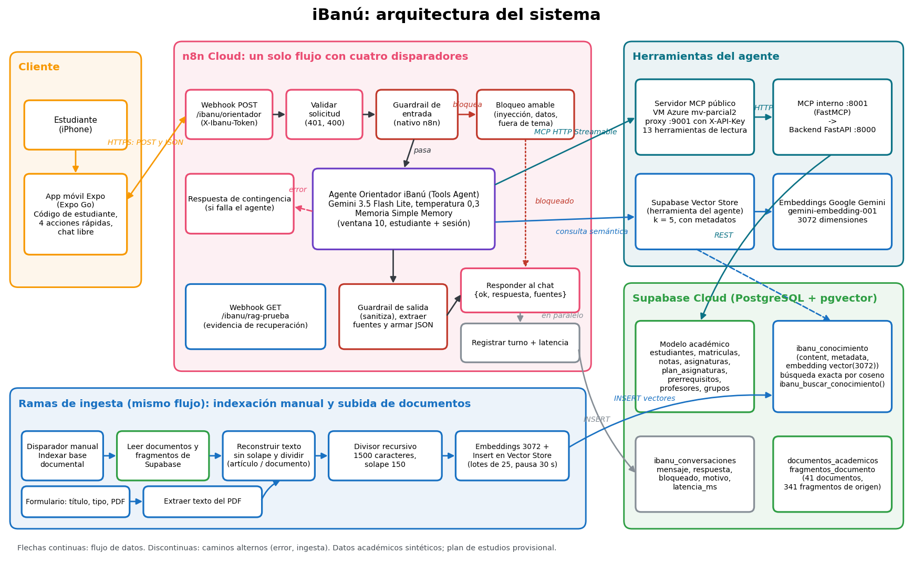
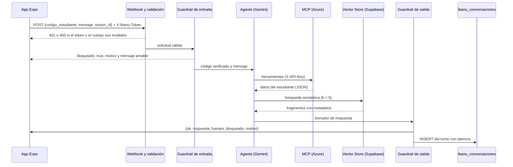

# Arquitectura de iBanú

Documento técnico complementario al [README](../README.md). Describe los componentes, el flujo de datos, las decisiones de diseño y el análisis que sustenta los parámetros del RAG.

Versión vectorial: [arquitectura.svg](img/arquitectura.svg). Se regenera con `python docs/img/generar_arquitectura.py` (requiere matplotlib).

## 1. Vista general

iBanú tiene cuatro capas:

1. **Cliente.** App Expo en Expo Go. Solo conoce el webhook y un token.
2. **Orquestación.** Un único flujo de n8n Cloud con cuatro disparadores. Valida, protege, razona (agente), consulta herramientas y responde.
3. **Herramientas.** Un servidor MCP (13 funciones de lectura) alojado en una VM de Azure, que consulta un backend FastAPI; y un almacén vectorial (RAG) en Supabase.
4. **Datos.** Supabase Cloud con PostgreSQL y pgvector: modelo académico, conocimiento vectorizado y registro de conversaciones.

### Disparadores del flujo

| Disparador | Endpoint o evento | Propósito |
|---|---|---|
| Chat de la app | `POST /webhook/ibanu/orientador` | Consulta del estudiante |
| Prueba del RAG | `GET /webhook/ibanu/rag-prueba?q=...&k=5` | Evidencia de recuperación |
| Indexación | Disparador manual "Indexar base documental" | Vectorizar el corpus |
| Subida de documentos | Formulario "Subir documento académico" | Agregar un PDF nuevo al conocimiento |

## 2. Flujo de datos del chat

Los tres desenlaces (respuesta normal, bloqueo y contingencia por falla del agente) confluyen en el nodo "Armar respuesta del chat", que calcula la latencia y entrega siempre el mismo formato de JSON.

## 3. Decisiones de diseño

| Tema | Decisión | Alternativa descartada y razón |
|---|---|---|
| Orquestación | Un flujo con cuatro entradas | Varios flujos o subflujos: más piezas que desplegar y sincronizar; el proyecto pide un solo flujo. |
| Razonamiento | Un agente de herramientas que decide qué consultar | Clasificador de intención más una rama por intención: más llamadas al modelo y más puntos de fallo; el agente con un buen prompt cubre matrícula, estado, proyección y recomendaciones. |
| Seguridad | Reglas sin modelo primero, modelo después | Todo con modelo: más costo y latencia; las reglas gratuitas ya detienen el grueso de los ataques. |
| Identidad | El código se verifica en el webhook y se entrega al agente en el mensaje de sistema | Tomar el código del texto: permitiría pedir datos ajenos. La salida además reemplaza códigos distintos del verificado. |
| Datos estructurados | MCP sobre HTTP con `X-API-Key` | Consultar Postgres directo desde n8n: duplicaría la lógica de negocio del backend; el MCP ya existía y es de solo lectura. |
| Exposición | Proxy público en el puerto 9001 que valida la clave y reenvía al MCP interno | Abrir el MCP interno: no tenía autenticación. El proxy es aditivo y no modifica el servicio original. |
| Vectores | pgvector en la misma base | Base vectorial aparte: otra cuenta y otra credencial; Supabase ya aloja los datos. |
| Embeddings | `gemini-embedding-001`, 3072, búsqueda exacta | HNSW con 768 dimensiones: el nodo nativo no permite recortar la dimensión; con unos cientos de fragmentos la búsqueda exacta es instantánea y tiene recall del 100 %. |
| Modelo de chat | `gemini-3.5-flash-lite`, temperatura 0,3 (respaldo `gemini-3.5-flash`) | Un modelo mayor: más latencia y costo sin ganancia clara para consultas guiadas por herramientas. |
| Memoria | Simple Memory, ventana de 10, clave `código + sesión` | Memoria en PostgreSQL: más infraestructura; para una conversación de orientación 10 mensajes bastan. |
| Registro | Tabla `ibanu_conversaciones` con latencia | Solo el historial de n8n: se pierde por retención y no es consultable con SQL. |
| Cliente | Expo Go | APK nativo: requiere compilar y firmar; Expo Go permite probar de inmediato en iPhone y Android. |

## 4. Seguridad por capas

| Capa | Mecanismo |
|---|---|
| Entrada del chat | Cabecera `X-Ibanu-Token`, longitud del mensaje, formato del código |
| Contenido | Guardrail de entrada (reglas más dos clasificaciones con Gemini, umbral 0,8) |
| Agente | Prompt con regla de identidad, no revelar instrucciones, contenido de herramientas tratado como información |
| Herramientas | MCP de solo lectura; el proxy exige `X-API-Key` |
| Salida | Guardrail de salida (sanitiza) y depuración de códigos ajenos |
| Datos | RLS activo en las tablas nuevas; permisos solo para `service_role` |
| Secretos | En credenciales de n8n y en archivos `.env`; ninguno en el repositorio |

El token de la app va en el código de la app (aceptable para la demostración); la lista de limitaciones del README propone autenticación por estudiante como trabajo futuro.

## 5. Modelo de datos y objetos nuevos

El modelo académico (estudiantes, planes, asignaturas, prerrequisitos, grupos, matrículas, notas, turnos) viene de las migraciones 001 a 005. Los scripts de `database/migrations/n8n/` agregan, sin tocar lo existente:

- `ibanu_conocimiento (id bigserial, content text, metadata jsonb, embedding vector(3072))`, con índice GIN sobre `metadata`, sin índice vectorial. Las columnas tienen esos nombres porque los usa el nodo Supabase Vector Store.
- `ibanu_buscar_conocimiento(query_embedding vector(3072), match_count int default 5, filter jsonb default '{}')`, que devuelve `id, content, metadata, similarity` ordenado por distancia coseno.
- `ibanu_conversaciones (id, creado_en, codigo_estudiante, sesion_id, canal, mensaje, respuesta, bloqueado, motivo, latencia_ms)` con índices por estudiante y fecha y por sesión. No tiene clave foránea al estudiante a propósito: también se registran intentos con códigos inexistentes.
- 25 filas en `prerrequisitos`, tomadas de las guías de cátedra.

## 6. Análisis del corpus y parámetros del RAG

### 6.1 Corpus de origen

| Categoría | Documentos | Fragmentos | Caracteres | Longitud media, mediana y máxima |
|---|---|---|---|---|
| reglamento | 1 | 144 | 112.424 | 781, 549 y 4.064 |
| materias (30 guías oficiales y 8 sintéticas) | 38 | 127 | 184.258 | 1.451, 1.416 y 2.199 |
| programa (página oficial y Propuesta de Competencias Digitales V11) | 2 | 70 | 57.221 | 817, 622 y 2.186 |
| Total | 41 | 341 | 353.903 | 1.038, 863 y 4.064 |

Aproximadamente 93.000 tokens (353.903 caracteres entre 3,8 por token en español con tildes).

### 6.2 Cómo estaba fragmentado

Los 341 fragmentos de origen no eran uniformes:

1. **Reglamento:** un fragmento por artículo, sin solape; siete artículos pasan de 2.000 caracteres.
2. **Guías de cátedra:** ventanas de 2.200 caracteres con solape de 300, reiniciadas en cada página del PDF; frases partidas en el borde de página y cabecera institucional repetida como ruido.
3. **Propuesta de competencias y página del programa:** por encabezados y bloques, con la sección rellena.

Todos se pueden reconstruir sin pérdida concatenando por `numero_fragmento` (quitando el solape de 300 entre fragmentos de la misma página de una guía), de modo que no hace falta volver a los PDF para reindexar. La codificación es correcta (sin caracteres de reemplazo).

### 6.3 Parámetros de la reindexación

| Tipo | Divisor | Tamaño objetivo | Máximo | Solape |
|---|---|---|---|---|
| Reglamento | Por artículo; si pasa del máximo, por numerales y párrafos | El artículo completo (mediana 549) | 1.800 | 150 solo entre partes del mismo artículo |
| Guías de cátedra | Por sección numerada y luego divisor recursivo | 1.200 | 1.500 | 150 (10 a 12 %) |
| Programa y competencias | Por encabezado y divisor recursivo para bloques largos | 1.200 | 1.500 | 150 |

En n8n esto es el nodo Divisor recursivo de texto con tamaño 1.500 y solape 150, precedido de un paso de código que corta el reglamento por artículo. Los separadores en orden: párrafo, salto de línea, punto, punto y coma y espacio. Cada fragmento se vectoriza con un prefijo de contexto (por ejemplo "Reglamento Estudiantil de Pregrado UNAB, Capítulo X, Artículo 40: ...").

### 6.4 Justificación

1. **La unidad semántica del reglamento es el artículo.** Regula una sola materia (matrícula, cancelación, promedio, plagio) y la pregunta de un estudiante casi siempre se responde con un artículo completo. Cortar cada N caracteres mezcla el final de un artículo con el comienzo del siguiente y produce vectores ambiguos. Un fragmento por artículo permite citar "Artículo N" y la página como evidencia, y por eso no necesita solape.
2. **Las guías se dividen por sección.** Las secciones (Identificación, Competencias, Contenidos, Evaluación, Bibliografía) son las unidades que busca el estudiante ("¿cómo se evalúa X?"). Un tamaño de 1.200 a 1.500 caracteres (300 a 400 tokens) cabe en una idea sin diluir el vector con temas distintos; las ventanas de 2.200 caracteres de origen mezclaban secciones y arrastraban la cabecera repetida.
3. **Solape de 150 caracteres (unos 10 %).** Es suficiente para no perder una frase que cae en el borde y no duplica el contenido ni el costo de embeddings. Solape mayor aumenta fragmentos casi iguales en los resultados.
4. **Prefijo de contexto.** El vector lleva el nombre del documento y de la sección, lo que mejora la recuperación de consultas que mencionan la asignatura o el artículo y permite que la respuesta cite la fuente.
5. **Modelo de embeddings.** `gemini-embedding-001` es multilingüe (el corpus está en español), pertenece a la misma familia de la clave del proyecto y es el que expone el nodo nativo de n8n, que entrega 3072 dimensiones sin opción de recortarlas. Se asumió ese costo (más almacenamiento por fragmento) a cambio de no depender de nodos externos.
6. **Búsqueda exacta por coseno.** pgvector limita los índices HNSW e IVFFlat a 2000 dimensiones. Con unos 400 a 500 fragmentos, el recorrido completo tarda milisegundos y devuelve siempre los vecinos más cercanos (recall del 100 %). Si el corpus crece a decenas de miles de fragmentos habría que reducir la dimensión o usar una columna `halfvec`.
7. **Metadatos.** `tipo`, `titulo`, `fuente`, `version`, `articulo`, `capitulo`, `seccion`, `pagina`, `codigo_asignatura`, `semestre`, `sintetico` y `documento_id` permiten citar, filtrar con `@>` (por ejemplo, solo reglamento) y avisar si una respuesta se apoya en una guía sintética. `documento_id` hace la indexación idempotente: se borran los fragmentos previos del mismo documento antes de insertar.

### 6.5 Indexación por lotes

El disparador manual recorre las unidades en lotes de 10, con una pausa de 65 segundos entre lotes por los límites por minuto de embeddings del plan gratuito de Gemini. Con lotes de 25 y pausa de 30 s (y luego de 10 y 45 s) la API dejó de entregar vectores y la inserción falló; con 10 unidades (unos 50 fragmentos, unos 20 mil tokens) y 65 s la indexación completa terminó en 22 min 15 s con 401 fragmentos. Si aparecen errores 429 o vectores vacíos se aumenta la pausa del nodo "Pausa por límite de Gemini". Al terminar, el nodo "Resumen de indexación" informa el total.

### 6.6 Evaluación de la recuperación

Con la indexación completa (401 fragmentos) se evaluó la recuperación con 20 preguntas de respuesta conocida y 2 de control: acierto@1 95 %, acierto@5 100 % y MRR 0,975, con búsqueda exacta y sin reranker. La tabla por pregunta, el análisis del único fallo (artículo 24 por delante del 10) y la nota sobre las preguntas de control están en el [README, sección 5](../README.md#5-rag); el resultado crudo, en [`evidencias/rag_evaluacion_2026-11-19.json`](evidencias/rag_evaluacion_2026-11-19.json). Los parámetros (1.500 caracteres, solape de 150, `gemini-embedding-001`, k = 5) se justifican en 6.4.

### 6.7 Elegibilidad de matrícula (herramienta `evaluar_elegibilidad`)

Ninguna de las 13 herramientas MCP devuelve prerrequisitos. Para no depender del modelo en el cruce, el flujo incluye un nodo Code Tool con una copia del plan (38 asignaturas y sus créditos) y de los 25 prerrequisitos. Recibe los códigos aprobados, en curso y pendientes y el semestre actual, y devuelve las asignaturas elegibles, las elegibles si aprueba lo que cursa, las bloqueadas con el prerrequisito que falta y el resumen de créditos con los semestres restantes (cargas de 15, 17 y 18). Limitación: la copia debe mantenerse sincronizada con la base de datos; el trabajo futuro es una herramienta de prerrequisitos en el servidor MCP.

## 7. Observabilidad

- Cada turno del chat queda en `ibanu_conversaciones` con canal (`app` o `curl`), si fue bloqueado, el motivo y la latencia de extremo a extremo.
- n8n conserva el historial de ejecuciones con la entrada y la salida de cada nodo.
- La herramienta `consultar_estado_plataforma` del MCP informa el estado del backend y de la conexión con Supabase.

## 8. Despliegue

Ver la sección 9 del [README](../README.md#9-instalación-y-despliegue). Resumen: tres servicios systemd en la VM de Azure (backend 8000, MCP interno 8001, proxy público 9001), Supabase Cloud con los cuatro scripts SQL en orden, n8n Cloud con tres credenciales y el flujo importado y publicado, y la app en Expo Go.
