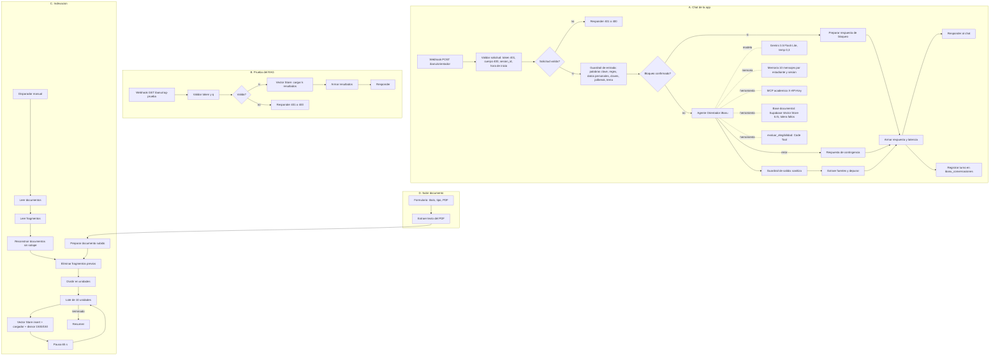

# Flujo único de n8n: iBanú, orientador académico

Archivo: `ibanu_flujo_unico.json` (n8n Cloud 2.47, 51 nodos: 45 funcionales y 6 notas adhesivas, versión final del 2026-11-19). Un solo flujo con cuatro disparadores: chat de la app, prueba del RAG, indexación manual y subida de documentos. El archivo no contiene claves: solo los nombres de las credenciales, que se crean a mano en n8n.

## Diagrama

## Los cuatro caminos, nodo por nodo

### A. Chat de la app (`POST /webhook/ibanu/orientador`)

| Nodo | Qué hace |
|---|---|
| Webhook chat orientador | Recibe el POST; responde mediante un nodo (responseNode). |
| Validar solicitud del chat | Código determinista: cabecera `X-Ibanu-Token` (401), formato del código, mensaje obligatorio de máximo 1000 caracteres y `sesion_id` válido (400). Genera `sesion_id` si falta, deduce el canal (`app` o `curl`; también acepta la cabecera `X-Ibanu-Canal`) y guarda la hora de inicio para medir la latencia. |
| ¿Solicitud válida? | Si no, "Responder solicitud inválida" devuelve `{"ok": false, "error": ...}` con 401 o 400. |
| Guardrail de entrada | Nodo nativo Guardrails (clasificar). Primero lo que no usa modelo: palabras clave y expresión regular de inyección, datos personales (correo, teléfono, tarjeta, IBAN, IP) y claves o tokens. Solo si pasa, dos comprobaciones con Gemini (umbral 0,8): intento de saltarse las instrucciones y tema ajeno a la orientación académica. Con `onError` continuar, de modo que un fallo del modelo no rompe el flujo (lo decide el nodo siguiente). |
| ¿Bloqueo confirmado? | Nodo If posterior al guardrail. Solo bloquea si una comprobación se disparó sin fallar (o si el nodo mismo dio error). Si el modelo del guardrail falló (por ejemplo "Failed to parse output" por un JSON truncado), el mensaje sigue al agente: las comprobaciones deterministas (palabras clave, expresión regular, datos personales y claves) ya se evaluaron y el prompt rechaza lo ajeno. Arregla un hallazgo de la prueba final: mensajes legítimos bloqueados por ese fallo. |
| Gemini para guardrail de entrada | Modelo del guardrail (flash-lite, temperatura 0, 256 tokens). |
| Preparar respuesta de bloqueo | Convierte el motivo (`inyeccion_de_instrucciones`, `datos_personales`, `datos_sensibles`, `fuera_de_tema`, `servicio_no_disponible`) en un mensaje amable. |
| Orientador iBanú | Agente de herramientas (v3.1). Recibe el código verificado y el mensaje; el prompt de sistema manda a consultar el MCP con ese código en cada turno (no responder de memoria), usar la base documental, calcular la elegibilidad con `evaluar_elegibilidad`, citar fuentes, no inventar datos, no revelar datos ajenos y, ante temas fuera de alcance (cafetería, clima, etc.), no llamar herramientas y declinar con amabilidad ofreciendo lo que sí puede hacer. Máximo 8 iteraciones y devuelve los pasos intermedios para extraer fuentes. |
| Gemini 3.5 Flash Lite | Modelo del agente (`models/gemini-3.5-flash-lite`, temperatura 0,3). Respaldo: cambiar a `gemini-3.5-flash`. |
| Memoria por estudiante y sesión | Simple Memory (ventana de 10) con clave `codigo_estudiante_sesion_id`. |
| Consultas académicas MCP | Cliente MCP (HTTP Streamable) a `http://20.201.114.161:9001/mcp` con la credencial Header Auth `iBanu MCP`. Expone las 13 herramientas de solo lectura. |
| evaluar_elegibilidad | Nodo **Code Tool** (JavaScript determinista, sin modelo). Entrada: códigos aprobados, en curso y pendientes y semestre actual. Cruza el plan (38 asignaturas con créditos del plan provisional) con los 25 prerrequisitos y devuelve `elegibles`, `elegibles si aprueba lo que cursa`, `bloqueadas` con el prerrequisito faltante y `resumen_creditos` (aprobados, en curso, por cursar y semestres restantes con cargas de 15, 17 y 18 créditos). Motivo: ninguna de las 13 herramientas MCP devuelve prerrequisitos y el modelo de chat se equivocó al cruzarlos y al sumar créditos. La tabla de prerrequisitos va también en el prompt como respaldo. **Debe mantenerse sincronizado con la base de datos** (ver Notas). |
| Base documental iBanú | Supabase Vector Store en modo recuperar como herramienta: tabla `ibanu_conocimiento`, función `ibanu_buscar_conocimiento`, k = 5, con metadata. `onError` en continuar: si falla, el agente responde con los datos del MCP y avisa "No pude consultar los documentos institucionales". |
| Embeddings para búsqueda del agente | Embeddings Google Gemini nativo (`gemini-embedding-001`, 3072 dimensiones) para la consulta. |
| Respuesta de contingencia | Si el agente falla (cuota, red): mensaje de reintento con `motivo = error_temporal`. |
| Guardrail de salida | Guardrails en modo sanitizar: enmascara tarjetas, IBAN, IP, claves y los tokens o cabeceras internos si el modelo los dejara escapar. |
| Extraer fuentes y depurar respuesta | Arma `fuentes`: agrega "Base de datos académica iBanú (MCP)" cuando alguna herramienta MCP respondió sin error y los `titulo` de los documentos cuando el RAG respondió (con la línea "Fuentes:" como respaldo); reescribe la línea "Fuentes:" del texto para que coincida con el arreglo. Si el agente llamó una herramienta con un código distinto al verificado, sustituye la respuesta por una negativa (`datos_de_terceros`). Además reemplaza códigos ajenos y limita la longitud. |
| Armar respuesta del chat | Fija el JSON final y calcula `latencia_ms` (ahora menos la hora de inicio). Aquí confluyen la ruta normal, la de bloqueo y la de contingencia. |
| Responder al chat | `{ok, respuesta, sesion_id, codigo_estudiante, fuentes, bloqueado, motivo}` según el contrato. |
| Registrar turno en Supabase | Inserta en `ibanu_conversaciones` (código, sesión, canal, mensaje, respuesta, bloqueado, motivo, latencia). Va en paralelo a la respuesta y, si falla, no afecta al usuario. Los mensajes bloqueados por datos personales se guardan como `[mensaje omitido: ...]`. |

### B. Prueba del RAG (`GET /webhook/ibanu/rag-prueba?q=...&k=5`)

Webhook prueba RAG, Validar solicitud de prueba RAG (token y `q`; `k` entre 1 y 10, por defecto 5), ¿Consulta válida?, Responder prueba inválida, Buscar en la base documental (Vector Store en modo cargar), Embeddings para prueba de RAG, Armar resultados de prueba y Responder prueba de RAG. La respuesta es `{"consulta": ..., "resultados": [{"contenido", "similitud", "metadata"}]}`.

### C. Indexación (disparador manual "Indexar base documental")

1. **Leer documentos académicos** y **Leer fragmentos de documentos** (todas las filas; el segundo se ejecuta una sola vez).
2. **Reconstruir documentos**: ordena los fragmentos por `numero_fragmento`, quita el solape detectando el mayor sufijo repetido (hasta 450 caracteres), limpia cabeceras repetidas y arma metadatos (`documento_id`, `titulo`, `tipo`, `fuente`, `version`, `sintetico`, `codigo_asignatura`). El reglamento conserva un fragmento por artículo.
3. **Eliminar fragmentos previos**: borra de `ibanu_conocimiento` las filas con el mismo `metadata->>documento_id`. Así se puede reindexar sin duplicar (idempotente).
4. **Dividir en unidades de indexación**: una unidad por artículo del reglamento y una por documento en los demás; antepone el contexto ("Reglamento..., Artículo N: ...").
5. **Lote de unidades** (10) y bucle: **Indexar en Supabase Vector Store** (modo insertar, lotes de 50) con **Cargador de documentos** y **Divisor recursivo de texto** (1500 caracteres, solape 150, valores de `08_rag_parametros.md`) y **Embeddings para indexación**, seguido de **Pausa por límite de Gemini** (65 s) antes del siguiente lote. Un lote de 10 unidades da unos 50 fragmentos (unos 20 mil tokens), bajo el tope por minuto de embeddings. La indexación completa (401 fragmentos) tarda unos 22 minutos y la ejecución queda en estado "waiting" entre lotes. Al terminar, **Resumen de indexación**.

### D. Subir documento (formulario "Subir documento académico")

Formulario con título, tipo y PDF, **Extraer texto del PDF** y **Preparar documento subido** (el `documento_id` sale del título, de modo que subir de nuevo el mismo título reemplaza la versión anterior). Desde ahí entra al mismo camino de C a partir de "Eliminar fragmentos previos".

## Decisiones de diseño (para la rúbrica)

- Un único flujo con cuatro disparadores. Un solo agente de herramientas decide qué consultar, en lugar de un clasificador de intención y subflujos: menos llamadas al modelo y menos piezas.
- Guardrails nativos de n8n: primero las comprobaciones sin modelo (gratuitas) y después, solo si pasan, dos con Gemini. Cada turno consume 2 llamadas de guardrail más las del agente; si la cuota es justa, se puede quitar `topicalAlignment` del nodo (el prompt del agente ya rechaza lo ajeno).
- La identidad del estudiante la fija el flujo (código verificado en la solicitud), no el texto del mensaje; el código nunca se toma del texto y la salida enmascara códigos ajenos.
- Un solo almacén vectorial para chat, prueba e indexación. Metadatos que permiten citar y filtrar.
- Medición de latencia de extremo a extremo guardada en la base.
- El token de la app se compara en el nodo "Validar solicitud del chat" y en "Validar solicitud de prueba RAG" (constante `TOKEN_ESPERADO`, igual al del contrato). Si se rota, hay que cambiarlo en esos dos nodos y en la app.

## Credenciales

Se crean a mano en n8n (Credentials) y, tras importar, se eligen en cada nodo. El JSON solo lleva sus nombres.

| Nombre | Tipo | Datos | Nodos que la usan |
|---|---|---|---|
| iBanu Gemini | Google Gemini(PaLM) Api | clave de la API de Gemini | Gemini 3.5 Flash Lite, Gemini para guardrail de entrada y los tres nodos de embeddings |
| iBanu Supabase | Supabase API | host `https://udixkdmmqgoxdkhiblzv.supabase.co` y la service role key | Base documental iBanú, Buscar en la base documental, Indexar en Supabase Vector Store, Registrar turno, Leer documentos, Leer fragmentos, Eliminar fragmentos previos |
| iBanu MCP | Header Auth | nombre de la cabecera (campo Name) `X-API-Key`, valor `MCP_PUBLIC_API_KEY` | Consultas académicas MCP |

Son tres credenciales. Antes de importar: el dueño ejecuta `01_rag_vectorial.sql`, `02_conversaciones.sql` y `04_embeddings_3072.sql` en Supabase.

## Cómo importar

1. En n8n: Workflows > Add workflow > menú de tres puntos > Import from file > `ibanu_flujo_unico.json`.
2. Crear las tres credenciales de la tabla anterior (Overview > Credentials > Create credential) y elegirlas en los nodos marcados en rojo.
3. Publicar el flujo (Publish). Solo así responden las URL `/webhook/...`; las `/webhook-test/...` funcionan al pulsar "Listen" en el editor.
4. Ejecutar antes en Supabase los scripts de `database/migrations/n8n/` (01 a 04).
5. Pulsar "Execute workflow" desde el disparador "Indexar base documental" para llenar `ibanu_conocimiento` (el reglamento y las guías de cátedra ya están en `fragmentos_documento`).

## Pruebas

Ver `../pruebas/` (scripts con curl y PowerShell) y la sección de pruebas del README. Después de probar, en Supabase: `select canal, bloqueado, motivo, latencia_ms from ibanu_conversaciones order by id desc limit 10;`.

## Notas

- Embeddings: el nodo nativo "Embeddings Google Gemini" no permite fijar `outputDimensionality` ni `taskType`; entrega los 3072 valores por defecto de `gemini-embedding-001`. Por eso la tabla se migra con `04_embeddings_3072.sql` y la búsqueda es exacta por coseno (pgvector limita el índice HNSW a 2000 dimensiones).
- El token de la app se compara en los nodos "Validar solicitud del chat" y "Validar solicitud de prueba RAG" (constante `TOKEN_ESPERADO`). Si se rota, hay que cambiarlo en esos dos nodos y en `mobile/src/config.ts`.
- Límites de Gemini por minuto: con lotes de 25 unidades y pausa de 30 s, y luego de 10 y 45 s, la API dejó de entregar vectores y la inserción falló con "vector must have at least 1 dimension" (el nodo nativo no falla: devuelve listas vacías). Los valores finales son 10 unidades y 65 s. Si reaparece el error, subir la pausa.
- `evaluar_elegibilidad` lleva incrustada una copia del plan y de los 25 prerrequisitos. Si cambian las tablas `asignaturas`, `plan_asignaturas` o `prerrequisitos`, hay que editar a mano el código de ese nodo y el prompt del agente. Trabajo futuro: una herramienta de prerrequisitos en el servidor MCP.
- Evaluación del RAG: acierto@1 95 %, acierto@5 100 % y MRR 0,975 con 401 fragmentos (ver README, sección 5, y `../docs/evidencias/`). Prueba final de extremo a extremo: `../docs/evidencias/prueba_final_e2e_2026-11-19.md`.
- `historico/ibanu-integracion-academica.json` es el flujo de monitoreo de la primera versión del proyecto; ya no forma parte de la solución.
